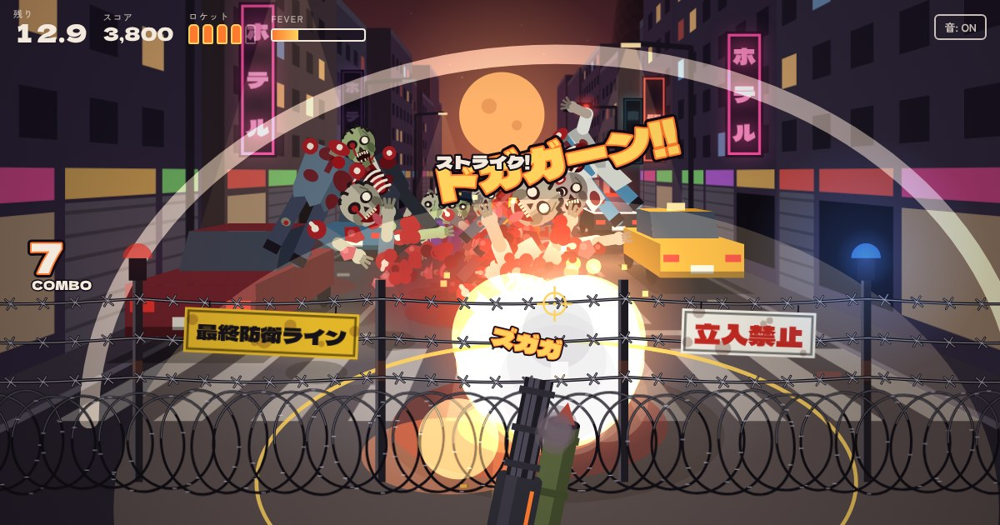

# ゾンビ爆散

迫り来るゾンビの大群を、ロケットランチャーや戦車、メダルで手に入るブラックホール・レールガン・波動砲・火炎放射器・電撃砲・ミサイル・ビットで吹き飛ばす10秒1本勝負の3Dブラウザゲームです。舞台は夜の大通り、夜の遊園地、夏祭りの参道、夜の高速道路で、トゲ付き鉄線フェンスが最終防衛ラインです。

**遊ぶ: https://zombie-bakusan.pages.dev/**

## 遊び方

- タイトル画面で武器を選びます。最初は「ロケラン」と「戦車」で、メダルを集めると「ブラックホール」（10枚）、「レールガン」（20枚）、「波動砲」（30枚）、「火炎放射器」（40枚）、「電撃砲」（50枚）、「ミサイル」（60枚）、「ビット」（70枚）が使えるようになります
- タイトル画面ではステージも選べます。「大通り」「遊園地」「夏祭り」「高速」のどれか、または「おまかせ」（毎回ちがうステージ）です
- どの武器もタップで撃ち、長押しすると連射します（火炎放射器は押している間ずっと炎が出ます）。弾数の制限はなく、画面上部の武器名の横は「∞」です。1回に出る数はどの武器も2発ずつ（ミサイルは20発、ビットは12基）です。武器ごとに手元の見た目もちがいます
- ロケランは爆発するロケット弾を撃ちます
- 戦車は主砲を撃ちます。主砲は並んだゾンビを串刺しにして突き抜けてから大爆発します
- メダルで手に入る武器では、ブラックホールはゾンビや車を吸い込んでから大爆発する黒い穴、レールガンは照準の先まで一瞬で貫く光線、波動砲は充填120%のあと通りを一直線に消し飛ばす極太ビーム、火炎放射器は浴びたゾンビが火だるまで走り回って周りに燃え移り、黒焦げで弾ける炎、電撃砲は群れを次々に飛び移り、骨まで透かしてから弾けさせる稲妻、ミサイルはロックオンした群れやドラム缶に20発が弧を描いて次々に突っ込む乱れ撃ち、ビットは筒から飛び出した12基の浮遊砲台が群れの上を囲んでビームで撃ち抜き、最後に全基で一斉射してから戻ってくる遠隔攻撃です
- PCはクリック、右クリック、スペースキーで撃てます（押しっぱなしで連射）。画面はスマホと同じ縦長で、中央に表示します
- ドラム缶と車は撃つと大爆発、手前のビルはロケットを何発か当てると崩れて、その側の道にいるゾンビと車を下敷きにします。戦車の主砲なら一撃です
- 爆発すると道路もえぐれて、アスファルトの塊が舞い上がります。穴は赤く焼けたひび割れを残し、その回の間ずっと道路に残ります
- 倒し続けると左下のメーターが溜まり、満タンになると空爆が自動で飛んできます。戦闘機3機が奥から低空で迫り、大通りをフェンスの手前まで絨毯爆撃します。同時にFEVER（どの武器も連射がさらに速くなり、ロケットは1回に6発、火炎放射器は4本、ミサイルは28発、ビットは16基）になります
- ゾンビは最大170体が同時に押し寄せます。奥から来るほか、フェンスのすぐ先のマンホールからも這い出てきます
- 倒すと金貨と札束が舞う金ピカのゾンビ、撃つとボンベが火を噴いて飛んでいき大爆発するボンベ背負い、膨れ上がって破裂し周りをなぎ倒すデブのゾンビも混じります
- 毎回ひとつハプニングが起きます。突っ込んでくるタンクローリー、ゾンビ満員の観光バス、取材ヘリ、通りの真ん中で火を噴きはじめるガス管のマンホール6つ（撃つと火柱が次々に上がって群れを打ち上げます）、ゾンビをロープにぶら下げてサーチライトで通りを照らすゾンビ飛行船（ぶら下がりを撃ち落とすか、船ごと落とすと墜落して乗客が投げ出されます）のどれかで、撃てば派手に吹き飛びます
- どのステージにも、撃つと動く仕掛けが毎回1つか2つあります。クレーンに吊られた巨大鉄球は撃つと落ちて通りを転がり、群れをボウリングのようになぎ倒します。通りの上の電線は撃つと切れて群れの上に落ち、まとめて感電させます。奥のガスタンクは何発か当てると大爆発して、炎の壁が通りを手前まで押し寄せます
- 夜の遊園地では、奥の観覧車にロケットを何発か当てると手前に倒れてきて、ゴンドラが群れに飛び込んで爆発します。右上を走ってくるジェットコースターを撃つと脱線して、車両が1両ずつ群れに突っ込みます
- 夏祭りでは、参道の奥にある花火の打ち上げ台を撃つと大スターマインが始まります。花火が群れのいちばん濃いところへ次々に飛んで頭の上で破裂し、最後に鳥居の奥で尺玉が開きます
- 夜の高速道路では、奥のジャンクションの高架を撃つと、渋滞の車が1台ずつ燃えながら群れに降ってきて爆発し、最後にタンクローリーが落ちてきて大爆発、橋桁がV字に崩れ落ちます。屋根やボンネットにゾンビを乗せたゾンビカーも3台、群れを跳ね飛ばしながら突っ込んできます。撃てば乗っているゾンビごと吹き飛びます
- 毎回3つのお題（銅・銀・金）が出ます。達成するとメダルがもらえ、集めたメダルで新しい武器が解放されます。お題とメダルはそのブラウザに保存されます
- 途中で巨大ゾンビが来ます。空から1体降ってくるか、2体同時に降ってくるか、燃えながら霧の奥から駆けてくる巨大ゾンビ犬のどれかです。倒すと月まで飛んでいき、2体同時なら2体目は星になって「キラーン」と消えます。遠くまで吹き飛んだゾンビが月に当たることも
- 10秒たつと、残ったゾンビも車も巨大ゾンビもまとめて大爆発します
- 負けはありません。点になるのは、自分の弾から始まった爆発や誘爆、吹き飛んだ体のストライク、崩したビルや動かした仕掛けで倒したゾンビだけです。1発で11体目からは2倍。10秒で稼いだ点数でランク（C / B / A / S / SS / SSS）が決まります
- 結果画面では、その回いちばん大きな連鎖をスローで再生します
- 結果はXやLINEでシェアできます。終了直前からフィナーレの大爆発までを録った7秒ほどの縦長動画（最後にランクと点数）を、スマホでは共有、PCでは保存できます。動画を作れないブラウザ（Firefox など）では、フィナーレの写真に点数を載せた画像になります
- 世界ランキングがあります。毎回の結果画面に世界何位と今日何位が出ます。タイトル画面左上の「🏆 ランキング」（結果画面の順位をタップしても開きます）で、上位100人を「今日」と「全期間」で国旗つきで見られます。名前は最初「ゾンビハンター1234」のように自動で付き、ランキング画面の「名前を変える」で16文字まで変えられます（失礼な名前やURLは使えません）。今日のランキングは毎日9時（日本時間）にリセットされます
- Androidのスマホでは、空爆や波動砲、巨大ゾンビなど大きな場面で短く振動します
- 表示は日本語と英語です。ブラウザの言語が日本語なら日本語、それ以外なら英語で始まり、タイトル画面右上のボタンで切り替えられます（URLに `?lang=ja` か `?lang=en` を付けても選べます）。2D版は日本語だけです

最初に作った2D版も遊べます: https://zombie-bakusan.pages.dev/2d/

## 中身

- `index.html` が3D版、`2d/index.html` が2D版です。どちらも1枚のHTMLで、ビルドなしでブラウザから開けます
- 3D版の描画は [three.js](https://threejs.org/)（MIT、r182）で、jsDelivr から読み込みます。街もゾンビもコードで組み立てています
- 2D版は Canvas 2D の疑似3D で、外部ライブラリは使っていません
- 効果音は Web Audio でその場で合成しています
- 実況とうめき声は [Kokoro TTS](https://huggingface.co/hexgrad/Kokoro-82M)（Apache-2.0）で生成し、ファイルに埋め込んでいます
- フォントは Google Fonts の [Dela Gothic One](https://fonts.google.com/specimen/Dela+Gothic+One) と [Zen Kaku Gothic New](https://fonts.google.com/specimen/Zen+Kaku+Gothic+New)（SIL Open Font License）です
- 世界ランキングは Cloudflare Pages Functions（`functions/api/[[path]].js`、`_routes.json` で `/api/` だけに動かしています）と Cloudflare D1 で動いています。送るのは点数・撃破数・武器・ステージ・名前・表示言語と、ブラウザごとに作るランダムなID（`localStorage` に保存、ランキングには出ません）です。国旗の国はアクセス元から判定します。github.io の写しからも pages.dev のランキングを使い、ファイルを直接開いたときはランキングは出ません
- ランキングを動かすには、Cloudflare の D1 でデータベースを作り、Pages プロジェクトの Settings → Bindings に変数名 `DB` で足します（Production と Preview の両方）。表は最初のアクセスで自動で作られます。プレビューのURLでは名前に `t_` の付いた別の表を使うので、試しても本番のランキングには載りません
- アクセス解析に Google Analytics（GA4）を使っています。ページの表示のほか、ゲームの開始と終了（武器・ステージ・ランク・点数・表示言語）、空爆、シェアのボタン、ランキング画面を開いたことをイベントとして送ります

## English

ZOMBIE BAKUSAN (ゾンビ爆散, "zombies blown to bits") is a 10-second 3D browser game. Blow the oncoming horde away with a rocket launcher or a tank, and with the medals you earn unlock a black hole, a railgun, a wave cannon, a flamethrower, a shock gun, homing missiles and floating beam bits. There is no losing: keep the chain reactions going, bring the buildings down, cut loose the wrecking ball, drop the power lines on the horde, blow up the gas holder and send the giant zombie to the moon.

**Play: https://zombie-bakusan.pages.dev/?lang=en**

The game is in English unless your browser is set to Japanese; the button at the top right of the title screen switches languages.

There is a world ranking: after every round the result screen shows where you stand in the world, today and of all time. The 🏆 Ranking button at the top left of the title screen lists the top 100 with their flags, and you can change your name there (up to 16 characters). The daily board resets at 00:00 UTC.
