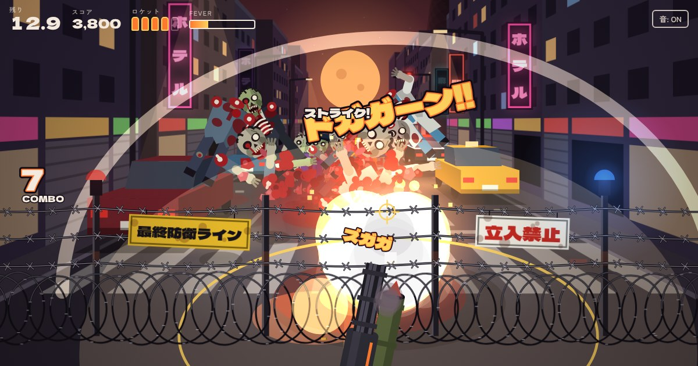

# ゾンビ爆散

迫り来るゾンビの大群を、マシンガンとロケットランチャー、または戦車で吹き飛ばす15秒1本勝負の3Dブラウザゲームです。舞台は夜の大通り、トゲ付き鉄線フェンスが最終防衛ラインです。

**遊ぶ: https://zombie-bakusan.pages.dev/**

## 遊び方

- タイトル画面で「ロケラン」か「戦車」を選びます
- ロケランは長押しでマシンガン、タップでロケット
- 戦車は長押しで機銃、タップで主砲。主砲は連射が遅いかわりに、並んだゾンビを串刺しにして突き抜けてから大爆発します
- PCは右クリックかスペースキーでもロケットや主砲を撃てます。画面はスマホと同じ縦長で、中央に表示します
- ドラム缶と車は撃つと大爆発、手前のビルはロケットを何発か当てると崩れて、その側の道にいるゾンビと車を下敷きにします。戦車の主砲なら一撃です
- 爆発すると道路もえぐれて、アスファルトの塊が舞い上がります。穴は赤く焼けたひび割れを残し、その回の間ずっと道路に残ります
- 倒し続けるとFEVER（マシンガン2倍とロケット撃ち放題、戦車は機銃2倍と主砲の連射）
- 大群は奥から押し寄せるほか、フェンスのすぐ先のマンホールからも這い出てきます
- 途中で巨大ゾンビが空から降ってきます。倒すと月まで飛んでいきます。遠くまで吹き飛んだゾンビが月に当たることも
- 15秒たつと、残ったゾンビも車も巨大ゾンビもまとめて大爆発します
- 負けはありません。点になるのは、自分の弾から始まった爆発や誘爆、吹き飛んだ体のストライク、崩したビルで倒したゾンビだけです。1発で11体目からは2倍、ヘッドショットも2倍。15秒で稼いだ点数でランク（C / B / A / S / SS / SSS）が決まります
- 結果はXやLINEでシェアできます。スマホではフィナーレの写真に点数を載せた画像で共有、PCではその画像を保存できます

最初に作った2D版も遊べます: https://zombie-bakusan.pages.dev/2d/

## 中身

- `index.html` が3D版、`2d/index.html` が2D版です。どちらも1枚のHTMLで、ビルドなしでブラウザから開けます
- 3D版の描画は [three.js](https://threejs.org/)（MIT、r182）で、jsDelivr から読み込みます。街もゾンビもコードで組み立てています
- 2D版は Canvas 2D の疑似3D で、外部ライブラリは使っていません
- 効果音は Web Audio でその場で合成しています
- 実況とうめき声は [Kokoro TTS](https://huggingface.co/hexgrad/Kokoro-82M)（Apache-2.0）で生成し、ファイルに埋め込んでいます
- フォントは Google Fonts の [Dela Gothic One](https://fonts.google.com/specimen/Dela+Gothic+One) と [Zen Kaku Gothic New](https://fonts.google.com/specimen/Zen+Kaku+Gothic+New)（SIL Open Font License）です
